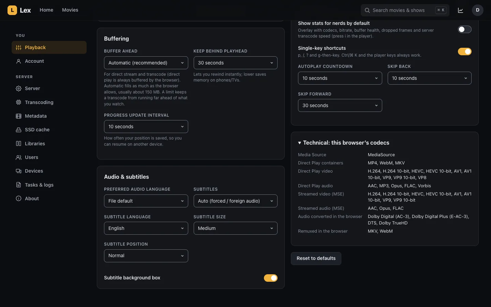
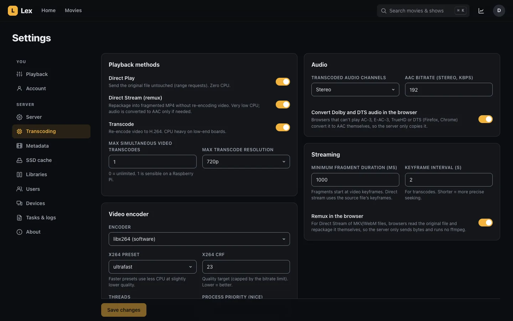

# Lex

A lightweight, self-hosted media server for small Linux hosts such as a
Raspberry Pi: one Go binary with SQLite, FFmpeg for media work, and a web UI
with no build step.

> [!NOTE]
> **Built by AI.** Lex was written by LLM coding agents under human direction.
> See [AI disclosure](#ai-disclosure).

## Why Lex

Most media servers decide on their own to transcode, and you find out when the
fan spins up. Lex is built around knowing **how each file will play in the
browser you're using, and why**:

- **It asks the browser.** The player reports exactly which containers and
  codecs this browser plays, and the server picks the cheapest way that works:
  play the file as it is, repackage it, or re-encode it.
- **It says why.** Every play records the reason it isn't a Direct Play
  ("container mkv not supported", "audio codec eac3 converted in the browser",
  "video codec mpeg4 not supported", "bitrate 18000 kbps over 8000 kbps
  limit"…). You see it in the player's stats, on the dashboard for live
  streams, and in the playback history and charts.
- **You choose where the work happens.** Repackaging MKV/WebM and converting
  Dolby/DTS audio can run **in the browser** (WebAssembly) so the server only
  sends bytes, or **on the server** with FFmpeg. Video is re-encoded only when
  the browser really can't decode it, and you can force any method from the
  player.

  
  

  
  

The same file can play differently from one browser to the next, and the
history shows it. Below, *Tears of Steel* (HEVC 10-bit, E-AC-3, MKV) is a
Direct Stream repackaged by Chrome itself, but a server transcode in a Firefox
that reported no HEVC 10-bit support; the Xvid AVI of *Elephants Dream* needs a transcode
everywhere.

Screenshots use the Blender Foundation's open movies *Sintel*, *Tears of
Steel*, *Big Buck Bunny*, *Elephants Dream* and *Caminandes: Gran Dillama*
(© Blender Foundation, [blender.org](https://www.blender.org/about/projects/),
CC BY). Posters and backdrops are frames from the films.

## How playback works

| Method | What happens | Cost |
| --- | --- | --- |
| **Direct Play** | The browser plays the original file with range requests. | None |
| **Direct Stream (in the browser)** | The browser reads the MKV/WebM and repackages it to fragmented MP4 itself; AC-3, E-AC-3, DTS and TrueHD audio is converted to AAC in the browser. | None on the server |
| **Direct Stream (on the server)** | FFmpeg repackages the file without touching the video; unsupported audio becomes AAC. | Low |
| **Transcode** | FFmpeg re-encodes to H.264 (libx264 or `h264_v4l2m2m`), for unsupported video, image subtitles, bitrate caps or HDR→SDR. | High |

If a method fails in the browser, the player falls back to the next one on its
own. Streams are fed through Media Source Extensions with no temporary files,
and ffmpeg pauses when the browser's buffer is full. Browsers without MSE
(older iOS, some TVs, AirPlay) get HLS.

## Features

- **Libraries**: Movies, TV Shows or Mixed. Parses release-style names,
  `.plexmatch`/`.nfo` ids, local artwork and local trailers/extras, and labels
  editions when a title has several versions. Sonarr/Radarr webhooks trigger
  instant rescans; admins get a list of unmatched titles and unreadable files.
- **Metadata**: TMDB (free key), TVmaze for shows, or a local Radarr. Artwork
  is cached and served by Lex. Collections, cast pages, genres, a per-user
  Watchlist and Favorites, and manual "Fix match".
- **Player**: resume, Up next, Skip Intro / Skip Credits (detected with audio
  fingerprints; a title counts as watched once the credits start), chapters,
  seek-bar thumbnails, speed, PiP, night mode and voice boost, keyboard and
  touch controls, audio and subtitle choices remembered per show, and **stats
  for nerds** (codecs in/out, reasons, buffer, bandwidth, dropped frames,
  server ffmpeg speed and disk wait). When playback buffers, the player says
  whether the network or the server (disk, CPU, memory, throttling) is why.
- **Subtitles**: embedded, external and OpenSubtitles.com downloads (optionally
  admins only); styled ASS/SSA rendered with libass and PGS (Blu-ray) drawn in
  the browser instead of burned in; timing, position, font, colour, edge and
  size controls.
- **Live TV**: optional channels that play your library at random on a fixed
  daily schedule, with a guide.
- **Dashboard**: host CPU, memory, temperature, network and disk; every live
  stream with its method, reason, buffer and ffmpeg state; playback analytics
  and history; a library breakdown by codec, resolution and HDR; a diagnostic
  report for bug reports with names, titles, paths and addresses hidden.
- **Users**: multiple accounts, per-user watch state and library access, admin
  roles, bcrypt passwords, hashed session tokens; everyone can see and sign out
  their own devices. Light and dark themes, or follow the system.
- **Raspberry Pi friendly**: hardware HEVC decoding and H.264 encoding when
  available, transcode limits you control, and an optional SSD cache that
  copies what you're watching off a slow hard drive. The copy starts at the
  play position, playback switches to it as soon as it's ahead, and it pauses
  while another stream waits on the drive.

## Documentation

- [Installing Lex](docs/install.md): build from source with Go **1.26.11 or newer**,
  run the Docker image, or install it as a service.
- [Backups](docs/backups.md): automatic database backups and restoring one.
- [Contributing](CONTRIBUTING.md): development checks, code layout and
  releases.
- [Security and privacy](SECURITY.md): read before exposing Lex beyond your LAN.

## AI disclosure

Lex was built by large language models: LLM coding agents wrote the server,
UI, tests, documentation and screenshots, while a human maintainer chose the
features, reported bugs and tested on real hardware. Commits name the model in
a `Co-Authored-By` trailer. The code and its checks have not had an independent
security review, so review Lex before exposing it to the internet. Lex calls no
AI service at runtime.

## License

[MIT](LICENSE). Third-party components, including the bundled subtitle
renderer and Raspberry Pi archive keys, keep their own terms; see
[third-party notices](THIRD_PARTY_NOTICES.md).
