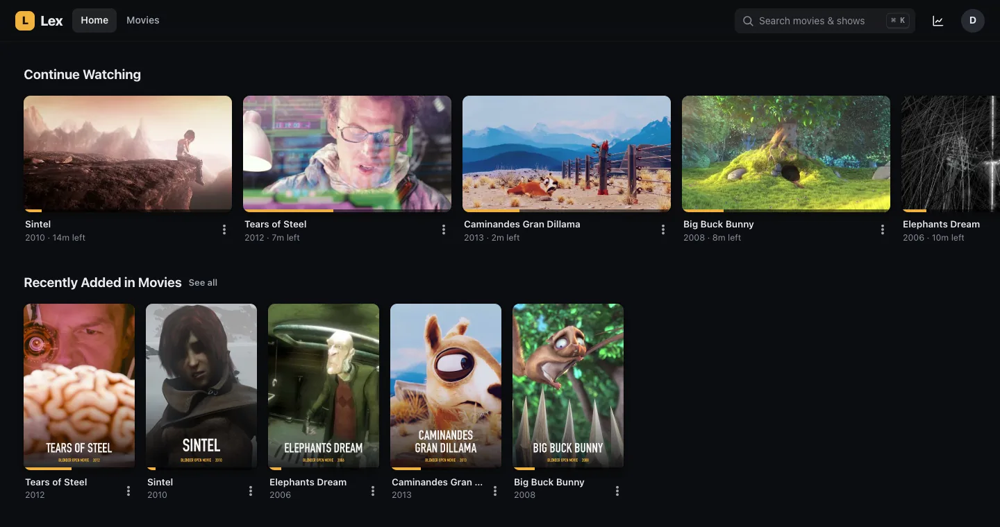
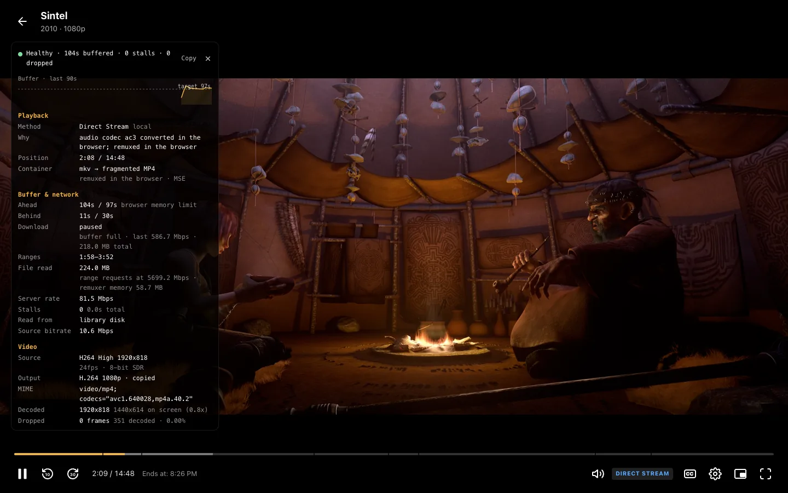
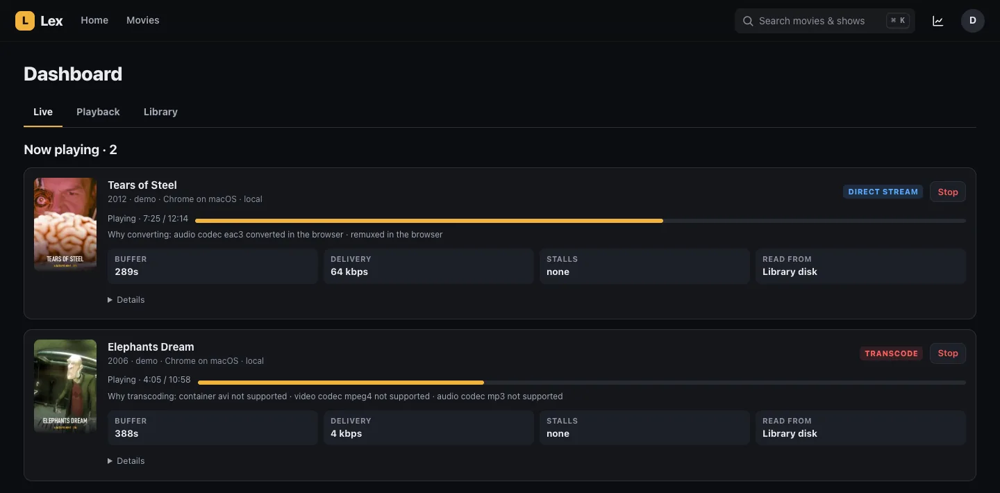
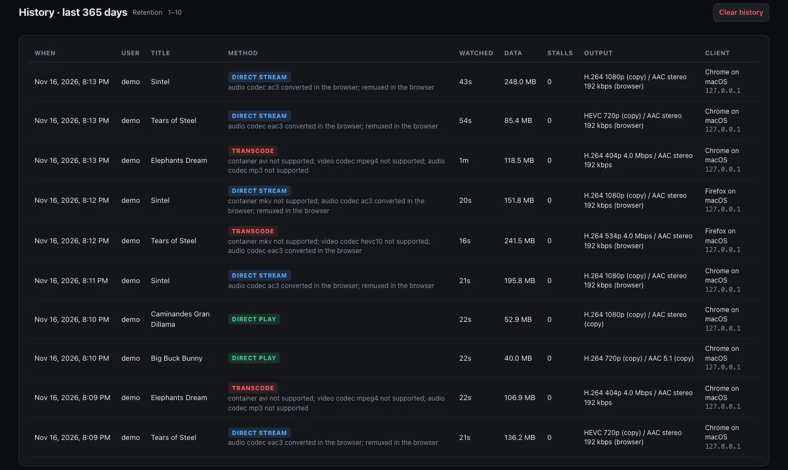

# Lex

A lightweight, self-hosted media server for small Linux hosts such as a
Raspberry Pi: one Go binary with SQLite, FFmpeg for media work, and a web UI
with no build step.

> [!NOTE]
> **Built by AI.** Lex was written by LLM coding agents under human direction.
> See [AI disclosure](#ai-disclosure).



## Why Lex

Most media servers decide on their own to transcode, and you find out when the
fan spins up. Lex is built around knowing **how each file will play in the
browser you're using, and why**:

- **It asks the browser.** The player reports exactly which containers and
  codecs this browser plays, and the server picks the cheapest way that works:
  play the file as it is, repackage it, or re-encode it.
- **It says why.** Every play records the reason it isn't a Direct Play
  ("container mkv not supported", "audio codec eac3 converted in the browser",
  "video codec mpeg4 not supported", "bitrate 18000 kbps over 8000 kbps
  limit"…). You see it in the player's stats, on the dashboard for live
  streams, and in the playback history and charts.
- **You choose where the work happens.** Repackaging MKV/WebM and converting
  Dolby/DTS audio can run **in the browser** (WebAssembly) so the server only
  sends bytes, or **on the server** with FFmpeg. Video is re-encoded only when
  the browser really can't decode it, and you can force any method from the
  player.

<p>
  
  
</p>
<p>
  
  
</p>

The same file can play differently from one browser to the next, and the
history shows it. Below, *Tears of Steel* (HEVC 10-bit, E-AC-3, MKV) is a
Direct Stream repackaged by Chrome itself, but a server transcode in a Firefox
that reported no HEVC 10-bit support; the Xvid AVI of *Elephants Dream* needs a transcode
everywhere.



<sub>Screenshots use the Blender Foundation's open movies *Sintel*, *Tears of
Steel*, *Big Buck Bunny*, *Elephants Dream* and *Caminandes: Gran Dillama*
(© Blender Foundation, [blender.org](https://www.blender.org/about/projects/),
CC BY). Posters and backdrops are frames from the films.</sub>

## How playback works

| Method | What happens | Cost |
| --- | --- | --- |
| **Direct Play** | The browser plays the original file with range requests. | None |
| **Direct Stream (in the browser)** | The browser reads the MKV/WebM and repackages it to fragmented MP4 itself; AC-3, E-AC-3, DTS and TrueHD audio is converted to AAC in the browser. | None on the server |
| **Direct Stream (on the server)** | FFmpeg repackages the file without touching the video; unsupported audio becomes AAC. | Low |
| **Transcode** | FFmpeg re-encodes to H.264 (libx264 or `h264_v4l2m2m`), for unsupported video, image subtitles, bitrate caps or HDR→SDR. | High |

If a method fails in the browser, the player falls back to the next one on its
own. Streams are fed through Media Source Extensions with no temporary files,
and ffmpeg pauses when the browser's buffer is full. Browsers without MSE
(older iOS, some TVs, AirPlay) get HLS.

## Features

- **Libraries**: Movies, TV Shows or Mixed. Parses release-style names,
  `.plexmatch`/`.nfo` ids and local artwork; Sonarr/Radarr webhooks trigger
  instant rescans.
- **Metadata**: TMDB (free key), TVmaze for shows, or a local Radarr. Artwork
  is cached and served by Lex. Collections, cast pages, genres, a per-user
  Watchlist and Favorites, and manual "Fix match".
- **Player**: resume, Up next, Skip Intro / Skip Credits (detected with audio
  fingerprints), chapters, seek-bar thumbnails, speed, PiP, keyboard and touch
  controls, and **stats for nerds** (codecs in/out, reasons, buffer, bandwidth,
  dropped frames, server ffmpeg speed).
- **Subtitles**: embedded, external and OpenSubtitles.com downloads; styled
  ASS/SSA rendered with libass in the browser; timing, size and position
  controls.
- **Live TV**: optional channels that play your library at random on a fixed
  daily schedule, with a guide.
- **Dashboard**: host CPU, memory, temperature, network and disk; every live
  stream with its method, reason, buffer and ffmpeg state; playback analytics
  and history; a library breakdown by codec, resolution and HDR.
- **Users**: multiple accounts, per-user watch state and library access, admin
  roles, bcrypt passwords, hashed session tokens.
- **Raspberry Pi friendly**: hardware HEVC decoding and H.264 encoding when
  available, an optional media cache, and transcode limits you control.

## Quick start

Build with Go **1.26.11 or newer** and install FFmpeg/FFprobe:

```sh
go build -trimpath -o lex ./cmd/lex
./lex -addr 127.0.0.1:8420 -data ./data
```

Open <http://localhost:8420>, create the first administrator, and add a library
(an absolute path) in Settings → Libraries. Lex listens on loopback by default;
use `-addr :8420` for LAN access behind a firewall, and read
[security and privacy](SECURITY.md) before exposing it further.

| Flag | Environment | Default |
| --- | --- | --- |
| `-addr` | `LEX_ADDR` | `127.0.0.1:8420` |
| `-data` | `LEX_DATA` | `./data` |
| `-ffmpeg` / `-ffprobe` | `LEX_FFMPEG` / `LEX_FFPROBE` | from `PATH` |
| `-debug` | `LEX_DEBUG=1` | off |
| `-version`, `-healthcheck` | — | print version / probe the server and exit |
| `-restore <file>` | — | replace the database with a backup and exit (stop Lex first) |

## Docker

A `linux/arm64` image is published to GitHub Container Registry
(`:latest`, `:<major.minor>`, `:<version>`, and `:edge` for manual builds of
`main`). On other platforms, `docker build -t lex .`.

```sh
docker run -d --name lex -p 127.0.0.1:8420:8420 --user 1000:1000 \
  -v lex-data:/data -v /path/to/media:/media:ro ghcr.io/mynamearnav/lex:latest
```

Or edit the media path in `docker-compose.yml` and run `docker compose up -d`.
Add `/media` as the library path in Lex. On a Raspberry Pi, add
`-f docker-compose.rpi.yml` to pass the hardware codec devices through; for
other arm64 boards build with `--build-arg RPI_FFMPEG=no`. HEVC hardware
decoding also needs the media controllers (`/dev/media*`) and a read-only
`/run/udev`; without them FFmpeg decodes in software and Settings → Transcoding
says why.

## Running as a service

`deploy/` has a systemd unit for the binary, a Podman Quadlet unit that follows
`:latest` with `podman auto-update`, `lex-hwcodec.service` for Raspberry Pi
codec modules, and `deploy.sh` to install either over SSH. Review paths, users
and device group IDs for your host first.

For remote access, put Lex behind an HTTPS reverse proxy or a VPN. If you
enable **Trust reverse-proxy headers**, list every proxy in **Trusted proxy
peers**. Clients outside **Local networks** get the **Remote bitrate limit**.
Settings → Server → **Sonarr & Radarr** connects Lex's rescan webhook with one
click (Lex adds it through their API, trying its addresses until the app's own
Test passes). The webhook URL carries its own token; keep it private.

## Backups

Lex backs up its database (users, watch history, matches, collections and
settings) daily and before every upgrade that changes it, into
`<data>/backups` or the folder set in Settings → Backups, keeping the newest
seven of each kind. Settings → Backups lists them and can back up now or
download one. Artwork, subtitles and seek previews aren't backed up; Lex
rebuilds them.

To restore, stop Lex and run `lex -data <data> -restore <file>`; the current
database is backed up first. With the container image:

```sh
docker run --rm -v lex-data:/data ghcr.io/mynamearnav/lex:latest \
  -restore /data/backups/<file>
```

## Development

```sh
go test -race ./...
go vet ./...
python3 scripts/check-publication.py
```

See [contributing](CONTRIBUTING.md) for the full checks, the code layout and
how releases are made, and the [publication audit](docs/PUBLISH_AUDIT.md) for
the privacy checks.

## AI disclosure

Lex was built by large language models: LLM coding agents wrote the server,
UI, tests, documentation and screenshots, while a human maintainer chose the
features, reported bugs and tested on real hardware. Commits name the model in
a `Co-Authored-By` trailer. The code and its checks have not had an independent
security review, so review Lex before exposing it to the internet. Lex calls no
AI service at runtime.

## License

[MIT](LICENSE). Third-party components, including the bundled subtitle
renderer and Raspberry Pi archive keys, keep their own terms; see
[third-party notices](THIRD_PARTY_NOTICES.md).
