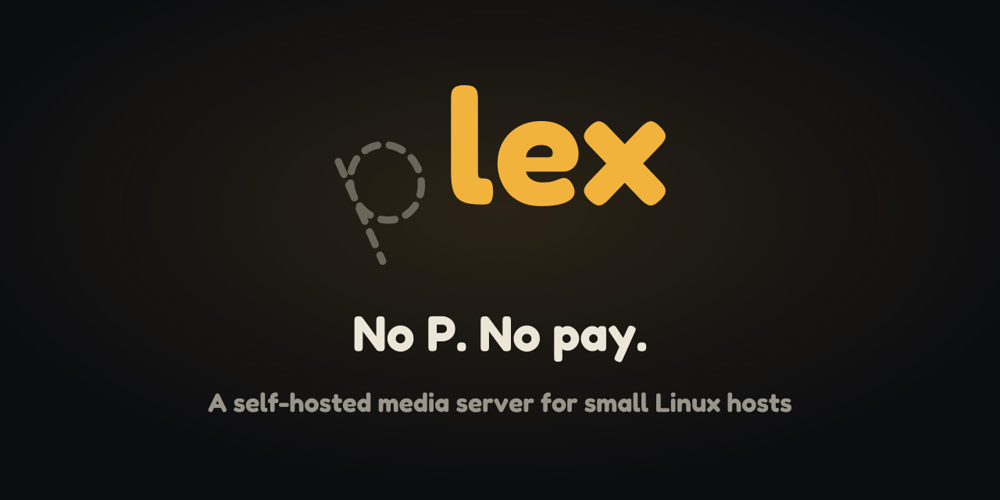

# lex

A lightweight, self-hosted media server for small Linux hosts like a Raspberry
Pi. One Go binary, SQLite, FFmpeg, and a web UI with no build step.

> [!NOTE]
> Built by LLM coding agents under human direction. See
> [AI disclosure](#ai-disclosure).

## Why lex

Most media servers transcode without telling you. lex tells you how each file
will play in your browser, and why:

- **Asks the browser** what it can play, then picks the cheapest option: play
  as-is, repackage, or re-encode.
- **Shows the reason** for every play that isn't direct, e.g. "audio codec eac3
  converted in the browser".
- **Lets you choose where the work runs**: repackaging and audio conversion can
  happen in the browser (WebAssembly) instead of on your Pi.

  
  

  
  

## Features

- Movies and TV libraries, with metadata from TMDB, TVmaze or Radarr
- Skip Intro / Skip Credits, chapters, seek thumbnails, stats for nerds
- Styled ASS/SSA and PGS subtitles, plus OpenSubtitles downloads
- Live TV: library channels and IPTV with a guide
- Dashboard with live streams, host stats and playback history
- Multiple users, per-user watch state and library access
- Pi-friendly: hardware decoding, transcode limits, optional SSD cache

Details: [features and how playback works](docs/features.md).

## Docs

- [Install](docs/install.md): from source (Go 1.26.11+), Docker, or as a service
- [Backups](docs/backups.md)
- [Contributing](CONTRIBUTING.md)
- [Security](SECURITY.md): read before exposing lex beyond your LAN

## AI disclosure

LLM coding agents wrote the code, tests, docs and screenshots; a human chose
the features and tested on real hardware. Commits name the model in a
`Co-Authored-By` trailer. lex hasn't had an independent security review, and it
calls no AI service at runtime.

## License

[MIT](LICENSE). Third-party components keep their own terms; see
[third-party notices](THIRD_PARTY_NOTICES.md).

Screenshots use the Blender Foundation's open movies (© Blender
Foundation, [blender.org](https://www.blender.org/about/projects/), CC BY).
