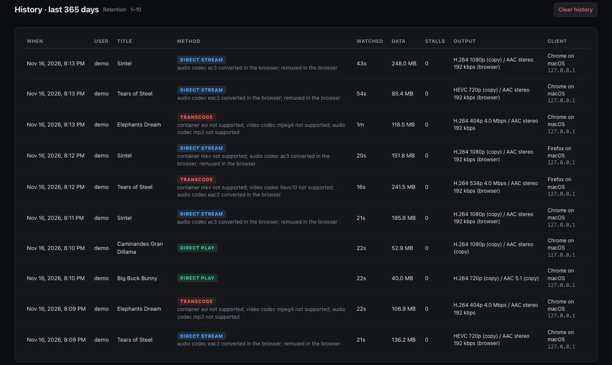

# Features

## How playback works

| Method | What happens | Server cost |
| --- | --- | --- |
| **Direct Play** | The browser plays the original file with range requests. | None |
| **Direct Stream (in the browser)** | The browser repackages MKV/WebM to fragmented MP4 itself and converts AC-3, E-AC-3, DTS and TrueHD audio to AAC. | None |
| **Direct Stream (on the server)** | FFmpeg repackages the file without touching the video; unsupported audio becomes AAC. | Low |
| **Transcode** | FFmpeg re-encodes to H.264 (libx264 or `h264_v4l2m2m`) for unsupported video, image subtitles, bitrate caps or HDR→SDR. | High |

The player asks the browser which containers and codecs it plays, and the
server picks the cheapest method that works. If a method fails, the player
falls back to the next one. Every play records why it wasn't a Direct Play
("container mkv not supported", "bitrate 18000 kbps over 8000 kbps limit", …),
shown in the player stats, the dashboard and the playback history.

Streams go through Media Source Extensions with no temporary files, and ffmpeg
pauses when the browser's buffer is full. Browsers without MSE (older iOS, some
TVs, AirPlay) get HLS.

The same file can play differently per browser. Below, *Tears of Steel* (HEVC
10-bit, E-AC-3, MKV) is repackaged by Chrome itself but transcoded on the
server for a Firefox without HEVC 10-bit; the Xvid AVI of *Elephants Dream*
needs a transcode everywhere.

## Libraries

- Movies, TV Shows or Mixed libraries.
- Parses release-style names, `.plexmatch`/`.nfo` ids, local artwork and local
  trailers/extras; labels editions when a title has several versions.
- Sonarr/Radarr webhooks trigger instant rescans.
- Admins get a list of unmatched titles and unreadable files.

## Metadata

- TMDB (free key), TVmaze for shows, or a local Radarr.
- Artwork is cached and served by lex.
- Collections, cast pages, genres, per-user Watchlist and Favorites, manual
  "Fix match".

## Player

- Resume, Up next, chapters, seek-bar thumbnails, speed, PiP.
- Skip Intro / Skip Credits, detected with audio fingerprints. A title counts
  as watched once the credits start.
- Night mode and voice boost.
- Keyboard and touch controls.
- Audio and subtitle choices remembered per show.
- Stats for nerds: codecs in/out, reasons, buffer, bandwidth, dropped frames,
  server ffmpeg speed and disk wait. When playback buffers, it says whether the
  network or the server (disk, CPU, memory, throttling) is the cause.

## Subtitles

- Embedded, external, and OpenSubtitles.com downloads (optionally admins only).
- Styled ASS/SSA rendered with libass and PGS (Blu-ray) drawn in the browser
  instead of burned in.
- Timing, position, font, colour, edge and size controls.

## Live TV

- Channels that play your library at random on a fixed daily schedule.
- Live IPTV channels: single streams or picked from an M3U playlist, with
  XMLTV guides.
- One numbered lineup and a grid guide.

## Dashboard

- Host CPU, memory, temperature, network and disk.
- Every live stream with its method, reason, buffer and ffmpeg state.
- Playback analytics and history.
- Library breakdown by codec, resolution and HDR.
- A diagnostic report for bug reports, with names, titles, paths and addresses
  hidden.

## Users

- Multiple accounts with per-user watch state and library access, and admin
  roles.
- bcrypt passwords and hashed session tokens; everyone can see and sign out
  their own devices.
- Light and dark themes, or follow the system.

## Raspberry Pi

- Hardware HEVC decoding and H.264 encoding when available.
- Transcode limits you control.
- Optional SSD cache that copies what you're watching off a slow hard drive.
  The copy starts at the play position, playback switches to it once it's
  ahead, and it pauses while another stream waits on the drive.
